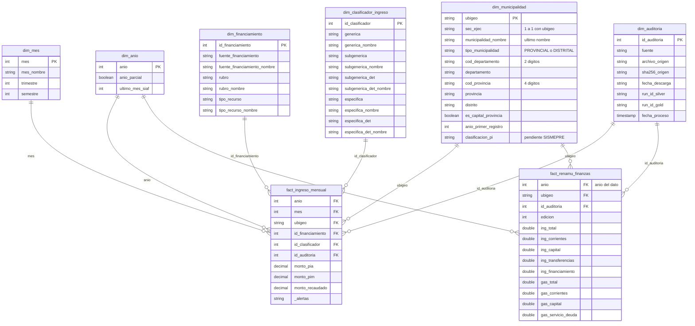
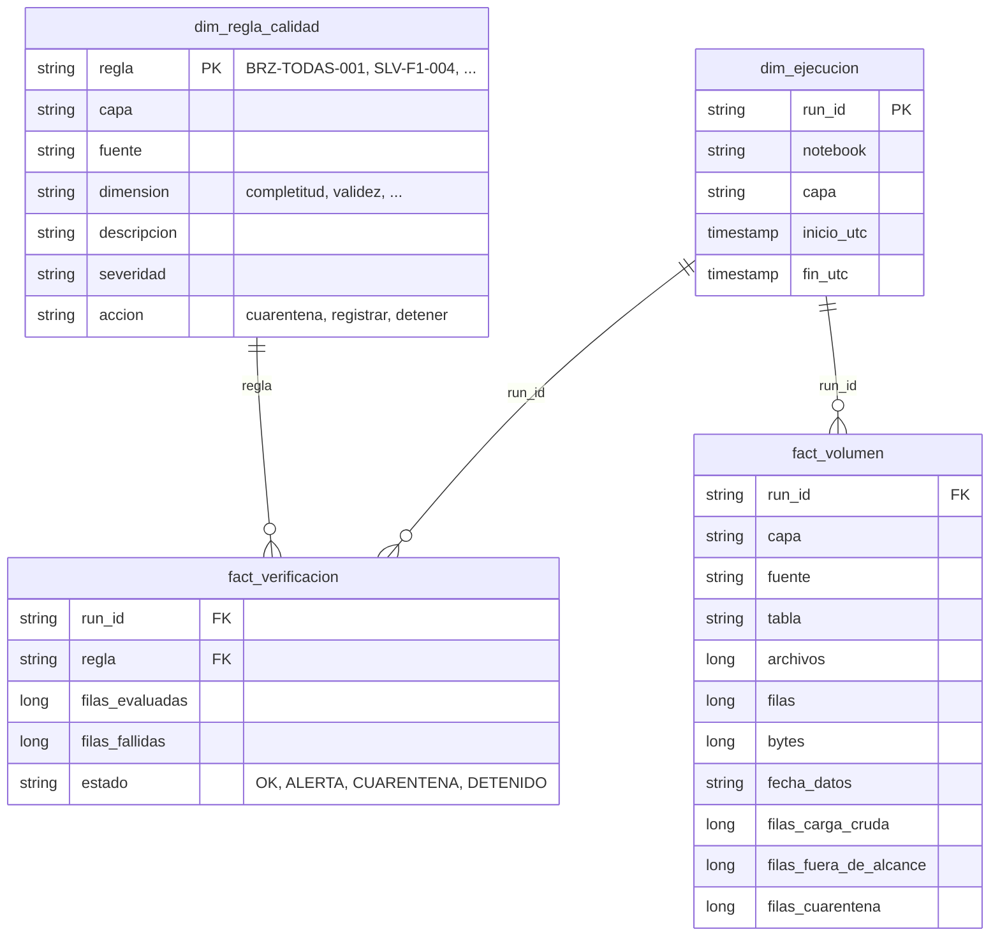

# Capa Gold: modelo estrella (propuesta para revisar)

| Tabla Silver | Filas | Grano | Estado |
| --- | --- | --- | --- |
| `siaf_ingreso` | 12 746 403 | año × mes × ejecutora × financiamiento × clasificador | Check |
| `renamu_finanzas` | 29 841 | edición × municipalidad (año del dato 2009–2025, sin 2014) | Check |
| SISMEPRE (`entidad_estado`, `esat_estadistica_atm`) | — | — | Pendiente |

---

## 1. Vista general

**Mermaid**:

**Dos hechos y seis dimensiones.** Los dos hechos comparten `dim_anio`, `dim_municipalidad` y `dim_auditoria`, y eso es lo que permite cruzar el SIAF con el RENAMU en un mismo dashboard.

---

## 2. Dimensiones

### `dim_municipalidad` — una fila por municipalidad (1 894)

| Columna | Origen | Nota |
| --- | --- | --- |
| `ubigeo` (PK) | SIAF | 6 dígitos. Es la llave de todo el modelo |
| `sec_ejec` | SIAF | Código de la ejecutora. Es **1 a 1 con `ubigeo` en todos los años** (verificado: 1 894 = 1 894 = 1 894 pares) |
| `municipalidad_nombre` | SIAF | **El último nombre** de la ejecutora (decisión de Silver: NAZCA → NASCA, …) |
| `tipo_municipalidad` | SIAF | PROVINCIAL / DISTRITAL (Lima = PROVINCIAL) |
| `cod_departamento`, `cod_provincia` | SIAF | 2 y 4 primeros dígitos del `ubigeo`: jerarquía departamento → provincia → distrito y mapas |
| `departamento`, `provincia`, `distrito` | SIAF | Nombres de la ubicación (los últimos) |
| `es_capital_provincia` | SIAF | Verdadero si el `ubigeo` termina en `01`: el distrito capital lo gobierna la municipalidad provincial |
| `anio_primer_registro` | SIAF | Primer año con datos. Sirve para ver los distritos creados después de 2009 (1 834 → 1 892) |
| `clasificacion_pi` | SISMEPRE | **Pendiente.** Tipo A–G del Programa de Incentivos (desde 2019 no cambia) |

> **¿Y una `dim_ubicacion`?** No hace falta: cada distrito tiene una sola municipalidad (1 894 `ubigeo` = 1 894 municipalidades), así que tendría las mismas filas y la misma llave. La ubicación va como columnas de esta dimensión.

### `dim_anio` — una fila por año (2009–2026)

| Columna | Nota |
| --- | --- |
| `anio` (PK) | |
| `anio_parcial` | Verdadero en 2026 (llega hasta noviembre) |
| `ultimo_mes_siaf` | 12, o el último mes con datos en el año parcial |
| `tiene_renamu` | Falso en 2014 (ninguna edición lo trae) y en 2026 (aún no publicado) |

### `dim_mes` — 12 filas

`mes` (PK), `mes_nombre`, `trimestre`, `semestre`. Solo la usa el hecho del SIAF.

### `dim_financiamiento` — de dónde viene el dinero

Jerarquía: **fuente de financiamiento → rubro → tipo de recurso**. Clave sustituta `id_financiamiento`.

| Fuente | Rubros (ejemplo, 2024, recaudado) |
| --- | --- |
| 2 Recursos directamente recaudados | 09 RDR (S/ 5,2 mil millones) |
| 3 Operaciones oficiales de crédito | 19 Crédito (3,3) |
| 4 Donaciones y transferencias | 13 Donaciones y transferencias (3,0) |
| 5 Recursos determinados | 07 FONCOMUN (9,7) · 08 Impuestos municipales (5,3) · 18 Canon, sobrecanon y regalías (18,3) |

Es la dimensión clave para separar **ingresos propios** (rubros 08 y 09) de **transferencias** (07, 13 y 18), una de las métricas que vendrán.

### `dim_clasificador_ingreso` — en qué concepto entra el dinero

Jerarquía del clasificador económico: **genérica → subgenérica → subgenérica detalle → específica → específica detalle**. Hay 432 combinaciones y una clave sustituta `id_clasificador`.

- La genérica tiene 9 valores y nunca cambia de nombre (1 Impuestos, 3 Venta de bienes y servicios, 4 Donaciones y transferencias, 9 Saldos de balance, …).
- Ejemplo: **impuesto predial** = `1.2.1.1.1` (S/ 2 224 millones en 2024) y `1.2.1.1.2` *Predial – regularización* (706).
- 4 combinaciones cambiaron de nombre entre años: se usa el último, igual que con las municipalidades.

### `dim_auditoria` — de dónde salió cada fila

Una fila por **archivo de origen y carga** (~18 del SIAF y ~23 del RENAMU). Los hechos llevan solo `id_auditoria` en vez de repetir la traza como texto en cada fila (en el SIAF serían 12,7 millones de veces los mismos 18 valores).

| Columna | Ejemplo |
| --- | --- |
| `id_auditoria` (PK) | 7 |
| `fuente` | F1 |
| `archivo_origen` | `data/bronze/siaf_ingreso/2015-Ingreso.csv` |
| `sha256_origen` | `b23f…` |
| `fecha_descarga` | 2026-11-20 |
| `run_id_silver`, `run_id_gold` | `silver_siaf_2026…` |
| `fecha_proceso` | fecha de la carga a Gold |

Desde cualquier monto de un dashboard se puede llegar a "esto vino de tal archivo, descargado tal día".

---

## 3. Hechos

### `fact_ingreso_mensual` (SIAF)

| | |
| --- | --- |
| **Grano** | año × mes × municipalidad × financiamiento × clasificador (el mismo de Silver) |
| **Filas** | ~12,7 millones |
| **Llaves** | `anio`, `mes`, `ubigeo`, `id_financiamiento`, `id_clasificador`, `id_auditoria` |
| **Medidas** | `monto_pia`, `monto_pim`, `monto_recaudado` (soles, decimal) |
| **Control** | `_alertas` (recaudado negativo, filas consolidadas) |

Se reemplazan los ~20 textos de Silver por **dos claves enteras**. Así la tabla queda angosta y Power BI la carga sin problema.

### `fact_renamu_finanzas` (RENAMU)

| | |
| --- | --- |
| **Grano** | año del dato × municipalidad (anual) |
| **Filas** | ~29 800 |
| **Llaves** | `anio` (= `anio_dato`), `ubigeo`, `id_auditoria` |
| **Medidas** | `ing_total`, `ing_corrientes`, `ing_capital`, `ing_transferencias`, `ing_financiamiento`, `gas_total`, `gas_corrientes`, `gas_capital`, `gas_servicio_deuda` |
| **Atributo** | `edicion` |

Es anual, así que no se une a `dim_mes`. Para comparar con el SIAF se usa el total anual del SIAF.

> **Por decidir (boceto):** en Silver la tabla también trae tres columnas de control que todavía no se pasan a este hecho:
> - `estado_ingresos` y `estado_gastos`: si la municipalidad entregó el cuadro (`INFORMO`, `NO_INFORMO` en 33 filas de 2009–2011, `SIN_RESPUESTA` en 1 de 2023). Separan "ingresó 0" de "no se sabe". En los datos, los dos estados coinciden siempre.
> - `_alertas`: reglas de calidad que la fila no cumplió (`SLV-F3-005` total ≠ suma de categorías, 1 fila; `SLV-F3-006` montos negativos, 8; `SLV-F3-007` no informó, 34).

### Pendiente: SISMEPRE

Cuando esté en Silver:
- `clasificacion_pi` se agrega como una columna de `dim_municipalidad`;
- si se usa la estadística del predial (ESAT), entra como un tercer hecho anual, `fact_predial`, con las mismas llaves `anio` y `ubigeo`.

No hay que rehacer nada de lo anterior.

---

## 3b. Mini-modelo para el dashboard de calidad

No usa los hechos de negocio: sale de las **bitácoras** y de `config.yaml`, que ya existen.

| Tabla | Sale de |
| --- | --- |
| `dim_regla_calidad` | `config.yaml → reglas_calidad` |
| `dim_ejecucion` | Una línea por ejecución en cada `bitacora_ejecuciones.jsonl` |
| `fact_verificacion` | El bloque `verificaciones` de las bitácoras (Bronze: `calidad`) |
| `fact_volumen` | `data/auditoria/volumenes.parquet` (ya existe) |

Responde: cuántas reglas fallan por capa y fuente, cómo bajan las filas de Bronze → Silver → Gold, qué se excluyó (fuera de alcance, cuarentena) y si la última carga está al día.

---

## 4. Reglas del modelo

- **Cada fila de un hecho tiene su dimensión.** Si un `ubigeo`, un `id_financiamiento`, un `id_clasificador` o un `id_auditoria` no existe en su dimensión, el notebook se detiene.
- **Cuadre con Silver:** la suma de PIA, PIM y recaudado por año en `fact_ingreso_mensual` es igual a la de `siaf_ingreso`, y la suma de `ing_total` y `gas_total` en `fact_renamu_finanzas` es igual a la de `renamu_finanzas`.
- **Nombres:** las dimensiones toman el último nombre. Los hechos no llevan nombres, solo claves.
- **Bitácora:** cada tabla de Gold registra su bloque `volumenes` (capa `gold`) y aparece en `data/auditoria/volumenes.parquet` debajo de Silver.
- **Notebooks:** `06_gold_dimensiones` y `07_gold_hechos`.

---

## 5. Puntos para decidir antes de las métricas

| # | Pregunta | Propuesta |
| --- | --- | --- |
| 1 | ¿El hecho del SIAF queda **mensual** (12,7 millones) o también se arma un **agregado anual**? | Mensual como hecho principal. Un agregado anual (año × municipalidad × financiamiento × genérica) solo si Power BI se pone lento |
| 2 | ¿El clasificador va en **una** dimensión con su jerarquía o se separa por niveles? | Una sola, con la jerarquía como columnas. Power BI arma el *drill-down* solo |
| 3 | ¿El RENAMU va como **hecho propio** o como columnas en `dim_municipalidad`? | Hecho propio: cambia cada año, no es un atributo fijo |
| 4 | ¿Los **distritos nuevos** aparecen todos los años en la dimensión? | Sí, una fila por municipalidad; los hechos solo tienen filas en los años en que existe |
| 5 | ¿El dashboard de **calidad de datos** sale del modelo estrella? | De un mini-modelo propio (sección 3b), armado con las bitácoras |
| 6 | ¿Hace falta el **mes** en algún dashboard? | Sí, para la estacionalidad de la recaudación. Si no, el hecho podría ser anual y mucho más chico |
